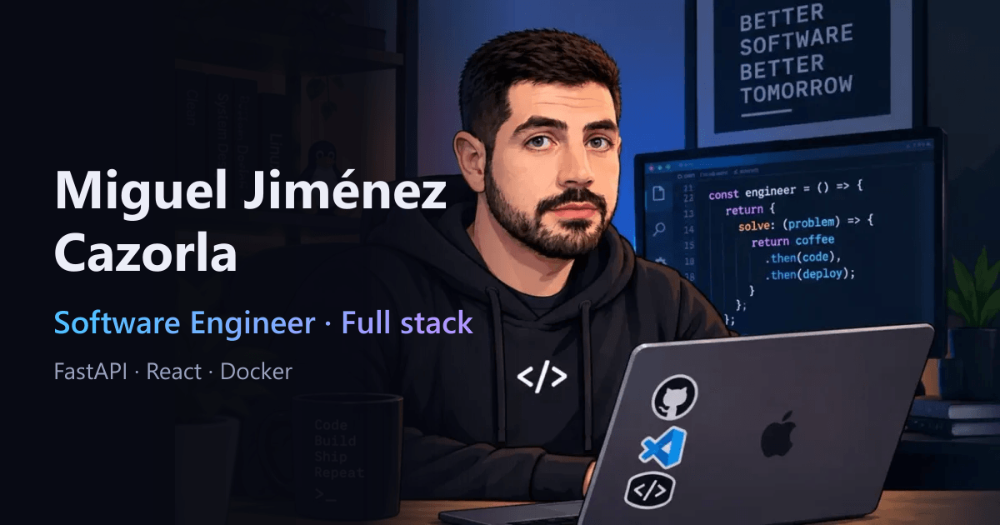

<div align="center">



# Portfolio · Miguel Jiménez Cazorla

**Software Engineer full stack.** Mi carta de presentación: quién soy, qué he construido y cómo trabajo.

[](https://imigueldev.duckdns.org)


</div>

---

## Contenido

- [Qué es](#qué-es)
- [Características](#características)
- [Stack](#stack)
- [Puesta en marcha](#puesta-en-marcha)
- [Editar el contenido](#editar-el-contenido)
- [Estructura del repositorio](#estructura-del-repositorio)
- [Despliegue](#despliegue)
- [Decisiones de diseño](#decisiones-de-diseño)

## Qué es

Una web de una sola página, bilingüe (español e inglés), con mi perfil profesional, mi experiencia, mi stack y el caso de estudio de [Applications Tracker](https://github.com/iMiguel10/applications-tracker), un proyecto full stack completo con FastAPI, React y PostgreSQL.

Está pensada para ser ligera: sin framework de UI ni librería de estilos, solo React, CSS propio y fuentes autoalojadas. El resultado es un sitio estático que pesa poco y se sirve con nginx.

## Características

| | |
|---|---|
| **Bilingüe** | Español e inglés con selector. Detecta el idioma del navegador y recuerda la elección. |
| **Contenido separado del código** | Todos los textos y enlaces viven en un único archivo tipado (`src/content.ts`). Añadir un idioma o un proyecto no toca los componentes. |
| **Galería de capturas** | Imagen principal con miniaturas y visor ampliado con teclado (flechas y Escape), construido sobre el elemento nativo `<dialog>`. |
| **Accesible** | Navegación por teclado, foco visible, enlace para saltar al contenido, textos alternativos, contraste cuidado y animaciones desactivadas si el usuario lo prefiere (`prefers-reduced-motion`). |
| **Adaptable** | Diseño fluido de móvil a pantalla ancha, sin desbordamiento horizontal. |
| **Rápido** | Imágenes en WebP con carga diferida, fuentes variables autoalojadas, sin dependencias de terceros en tiempo de ejecución ni analítica. |
| **SEO básico** | Metaetiquetas, Open Graph y Twitter Card, URL canónica, `robots.txt` y `sitemap.xml`. |

## Stack

| Capa | Tecnologías |
|---|---|
| **Frontend** | React 19 · TypeScript · Vite · CSS propio con variables |
| **Tipografía** | Bricolage Grotesque y Instrument Sans (Fontsource, autoalojadas) |
| **Servidor** | nginx (imagen Alpine) |
| **Infraestructura** | Docker multietapa · Coolify |
| **Calidad** | `tsc` en modo estricto · oxlint |

## Puesta en marcha

### Requisitos

- Node.js 24 (la versión que usa el Dockerfile), o solo Docker si prefieres no instalar nada.

### Desarrollo

```bash
npm install
npm run dev       # servidor de desarrollo con recarga en caliente
```

### Otros comandos

```bash
npm run build     # comprueba tipos y genera la versión de producción en dist/
npm run preview   # sirve dist/ en local
npm run lint      # análisis estático con oxlint
```

### Con Docker

```bash
docker build -t portfolio .
docker run --rm -p 8080:80 portfolio
```

La web queda en <http://localhost:8080>.

## Editar el contenido

| Quiero cambiar | Dónde |
|---|---|
| Textos en español e inglés, experiencia, stack, proyectos | `src/content.ts` |
| Enlaces (GitHub, LinkedIn, repo, demo) y email | `links` y `emailParts` en `src/content.ts` |
| Cuenta de demo del Tracker | `demoUser` y `demoPass` en `src/content.ts` (con la contraseña vacía el bloque se oculta) |
| Capturas del proyecto | Imágenes en `public/tracker/` y su lista, con pies de foto, en `projects.tracker.shots` |
| Foto y banner | `public/hero.webp`, `public/avatar.webp`, `public/favicon.png` |
| Imagen al compartir el enlace | `public/og.png` (1200 × 630) |
| Colores y tipografía | Variables al inicio de `src/index.css` |

Para añadir un idioma: ampliar el tipo `Lang` y añadir su bloque en `content`; el selector del encabezado se actualiza en `src/App.tsx`.

## Estructura del repositorio

```text
.
├── public/             Imágenes, favicon, robots.txt y sitemap.xml
│   └── tracker/        Capturas del proyecto en WebP
├── src/
│   ├── App.tsx         Secciones de la página
│   ├── Gallery.tsx     Galería y visor ampliado
│   ├── content.ts      Textos ES/EN, enlaces y datos del proyecto
│   ├── index.css       Estilos y variables de diseño
│   └── main.tsx        Punto de entrada
├── Dockerfile          Build multietapa: Node para compilar, nginx para servir
├── nginx.conf          Caché de assets, cabeceras de seguridad y fallback a index.html
└── index.html          Metaetiquetas y SEO
```

## Despliegue

El sitio se despliega con [Coolify](https://coolify.io) desde este repositorio, construyendo el `Dockerfile`:

1. Nuevo recurso **Public Repository** con este repositorio y la rama `main`.
2. **Build Pack:** Dockerfile. **Puerto:** 80.
3. **Dominio:** `https://imigueldev.duckdns.org`. Coolify gestiona el certificado HTTPS con Let's Encrypt.
4. Cada push a `main` puede redesplegar automáticamente mediante el webhook de Coolify.

El `Dockerfile` compila con `node:24-alpine` y copia solo `dist/` a una imagen `nginx:alpine`, así que la imagen final no contiene Node ni dependencias de desarrollo. Incluye `HEALTHCHECK`.

`nginx.conf` añade caché inmutable de un año a `/assets/` (los nombres llevan hash), compresión gzip y las cabeceras `X-Content-Type-Options`, `Referrer-Policy` y `X-Frame-Options`.

## Decisiones de diseño

- **Sin librería de estilos ni de componentes.** El sitio es pequeño y el diseño se va a seguir moviendo; unas variables CSS bastan y evitan una dependencia.
- **Contenido como datos tipados.** `Content` define la forma de cada bloque, y TypeScript obliga a que ambos idiomas estén completos.
- **`<dialog>` nativo para el visor.** Da gestión de foco, Escape y capa modal sin código adicional.
- **El correo no aparece como texto fijo.** Se construye en el cliente, para no dejarlo en claro en el HTML servido.
- **Sin formulario de contacto.** Evita mantener un backend solo para eso: el contacto es por email y LinkedIn.

---

<div align="center">

Hecho por [Miguel Jiménez Cazorla](https://github.com/iMiguel10) · [LinkedIn](https://www.linkedin.com/in/miguel-jim%C3%A9nez-cazorla-014807195/)

</div>
